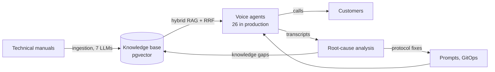

<picture>
  <source media="(prefers-color-scheme: dark)" srcset="assets/header-dark.svg">
  
</picture>

I build production voice agents at **[Konecto](https://konecto.ai)** and teach NLP at **Universidad de los Andes**.
4+ years building ML systems · MSc in Systems and Computing Engineering · Bogotá, Colombia

<picture>
  <source media="(prefers-color-scheme: dark)" srcset="assets/metrics-dark.svg">
  
</picture>

## What I build

Most of my work is in private repositories, so here is what it does without the internal names.

| Project | What it does |
|---|---|
| **In-house voice-agent platform** | Replaced a third-party voice-AI vendor. Multi-tenant control plane (React, FastAPI) with a visual routing canvas, dev-to-production promotion and post-call playbooks the agents learn from. |
| **Real-time voice worker** | Runs every call: streaming STT and TTS over WebRTC, voice-activity and turn detection, LLM tool calling, handoffs between specialist agents. |
| **Support agents for an enterprise manufacturer** | 26 agents in three languages with 16+ callable tools and Salesforce ticketing. Hybrid retrieval on PostgreSQL + pgvector with query expansion and Reciprocal Rank Fusion. |
| **Document-to-RAG ingestion** | Turns technical manuals (tables, diagrams) into retrieval-ready chunks in 8 stages across 7 LLM providers. Context caching cut LLM cost 10x. |
| **Post-call root-cause analysis** | Reads transcripts and classifies why a call escalated (missing knowledge, protocol violation, hallucination), feeding fixes back into the knowledge base and prompts. |
| **Voice-quality evaluation** | Initiated and directed with the team: pronunciation and audio scoring with forced alignment, GOP, WER and DTW. |
| **Agentic engineering workflow** | Deploys run by Claude Code subagents (phased releases, staging parity, drift detection, GO/NO-GO report) and a shared skills library that sets architecture and quality gates across repositories. |

How the support system closes the loop:

## Research

**MARSA: A Multi-accent, Multi-system Corpus of Full and Partial Voice Spoofing Attacks for Spanish Anti-spoofing Research** 
T. Acosta-Bernal, J.C. Vásquez-Correa, M.D. Calderón-Acosta, R.F. Manrique · manuscript in preparation for *Scientific Data* 
  
The first large-scale Spanish anti-spoofing corpus: 240,995 utterances, 1,567 speakers, 7 accent regions, 6 open voice-cloning systems, full and word-level partial spoofs.

**Eyes in the Sky: Deep Learning Processing of Airborne Sensor Imagery for Environmental Monitoring in the Colombian Amazon** 
T. Acosta-Bernal et al. · *IEEE TechDefense 2025*, Rome 
  
YOLO detection of illegal mining camps in aerial thermal (FLIR) video: 93.4% mAP@50.

**Multi-Agent Evolution for Electric Vehicle Charging Systems: A Scatter Search Approach to Breeding Specialized DQN Agents** 
T. Acosta Bernal, A. Tabares · in progress 
 
Reinforcement learning combined with MILP: five specialized DQN agent types for 592 vehicles, solving instances where MILP alone was infeasible on 35% of test systems.

## Teaching

Instructor at Universidad de los Andes for **Fundamentals of Natural Language Processing** and **Advanced Natural Language Processing** (master's level): Transformers, embeddings, fine-tuning, RAG and tool-using agents.
For the advanced course I built the final competition benchmark: a 216-document corpus and 1,500 validated questions to evaluate the students' RAG and tool-calling agents.

## Also on GitHub

| Repository | What it is |
|---|---|
| [bias_key_random_MDVRP](https://github.com/Tomas1307/bias_key_random_MDVRP) | Biased random-key genetic algorithm (BRKGA) in C++ for the multi-depot vehicle routing problem, with hyperparameter tuning over benchmark instances |

## Stack

Hugging Face · LangChain · pgvector · Deepgram · Langfuse · Claude Code

## Contact

[LinkedIn](https://www.linkedin.com/in/tomas-acosta-bernal-268856212/) · t.acosta@uniandes.edu.co
