<picture>
  <source media="(prefers-color-scheme: dark)" srcset="assets/header-dark.svg">
  
</picture>

  
  
  

I lead AI engineering at **[Konecto](https://konecto.ai)**, where we build voice agents that answer real customer calls, and I teach NLP at **Universidad de los Andes**. My research is on speech anti-spoofing for Spanish.

<picture>
  <source media="(prefers-color-scheme: dark)" srcset="assets/metrics-dark.svg">
  
</picture>

## What I do

- **Own the AI architecture** at Konecto: how agents are built, evaluated, deployed and improved, and which models and vendors we use.
- **Design voice-agent systems end to end**: real-time speech pipelines, retrieval over technical knowledge, tool calling and integrations with client systems.
- **Built our own voice-agent platform** to replace a third-party vendor, and the evaluation and deployment tooling around it.
- **Lead the engineering team**: planning, code review, hiring, and the AI-assisted workflow the team builds with.
- **Research and teach**: speech anti-spoofing, computer vision and reinforcement learning, and master's-level NLP courses.

## Research

**MARSA: A Multi-accent, Multi-system Corpus of Full and Partial Voice Spoofing Attacks for Spanish Anti-spoofing Research** 
T. Acosta-Bernal, J.C. Vásquez-Correa, M.D. Calderón-Acosta, R.F. Manrique · manuscript in preparation for *Scientific Data* 
  
The first large-scale Spanish anti-spoofing corpus: 240,995 utterances, 1,567 speakers, 7 accent regions, 6 open voice-cloning systems, full and word-level partial spoofs.

**Eyes in the Sky: Deep Learning Processing of Airborne Sensor Imagery for Environmental Monitoring in the Colombian Amazon** 
T. Acosta-Bernal et al. · *IEEE TechDefense 2025*, Rome 
  
YOLO detection of illegal mining camps in aerial thermal (FLIR) video: 93.4% mAP@50.

**Multi-Agent Evolution for Electric Vehicle Charging Systems: A Scatter Search Approach to Breeding Specialized DQN Agents** 
T. Acosta Bernal, A. Tabares · in progress 
 
Reinforcement learning combined with MILP: five specialized DQN agent types for 592 vehicles, solving instances where MILP alone was infeasible on 35% of test systems.

## Teaching

Instructor at Universidad de los Andes for **Fundamentals of Natural Language Processing** and **Advanced Natural Language Processing** (master's level). For the advanced course I built the final competition benchmark: a 216-document corpus and 1,500 validated questions to evaluate the students' RAG and tool-calling agents.

## Technologies

| Area | Tools |
|---|---|
| **LLMs and agents** | OpenAI, Anthropic, Gemini, open models (Llama, Qwen, Nemotron) · tool calling · MCP · LangChain · LangGraph · Langfuse |
| **Retrieval** | PostgreSQL + pgvector · hybrid search · Reciprocal Rank Fusion · re-ranking · Azure AI Search · FAISS |
| **Speech** | Deepgram · ElevenLabs · Retell · WebRTC · voice cloning (Fish Speech, Qwen3-TTS, OpenVoice) · forced alignment |
| **ML** | PyTorch · Hugging Face · fine-tuning (LoRA, PEFT) · YOLO · reinforcement learning (DQN) |
| **Backend and infra** | Python · FastAPI · Redis · Docker · Azure · AWS · GitHub Actions |
| **Frontend** | React · TypeScript · React Flow |

